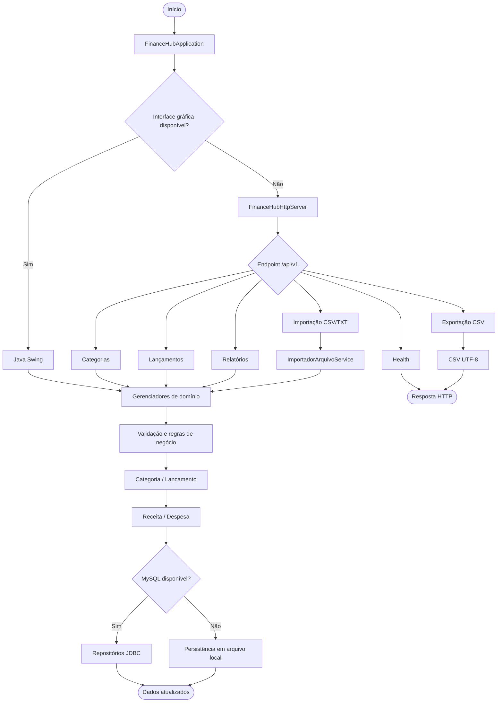

# FinanceHub — Gerenciador Financeiro Pessoal

Aplicação acadêmica desenvolvida em **Java 21** para o PjBL de Programação Orientada a Objetos da PUCPR. O projeto permite organizar receitas, despesas, categorias e relatórios financeiros, com interface desktop e API HTTP.

## Funcionalidades implementadas

- Cadastro, consulta e remoção de categorias.
- Gerenciamento de receitas e despesas com valores em `BigDecimal`.
- Cálculo de saldo e relatórios financeiros, inclusive por período.
- Interface desktop com Java Swing.
- API HTTP com o `HttpServer` nativo do JDK e rotas versionadas em `/api/v1`.
- Persistência JDBC em MySQL, com alternativa de armazenamento em arquivo local.
- Importação e exportação de lançamentos em CSV/TXT.
- Consulta de cotações de moedas pela AwesomeAPI.
- Testes automatizados com JUnit 5.

## Arquitetura e fluxo da aplicação

A classe `FinanceHubApplication` seleciona o modo de execução:

- **Com interface gráfica:** inicializa a aplicação desktop Java Swing.
- **Em ambiente headless:** inicializa o servidor HTTP Java. A porta padrão é `8080`, configurável pela variável de ambiente `PORT`.

As duas entradas utilizam os serviços e modelos do domínio. Na inicialização, o sistema tenta utilizar o MySQL; se a conexão não estiver disponível, utiliza o repositório em arquivo local.



O diagrama detalhado está em [docs/diagrams/fluxograma-financehub.md](docs/diagrams/fluxograma-financehub.md). A documentação complementar inclui [arquitetura](docs/arquitetura.md), [diagramas do PjBL](docs/diagrams/diagramas-pjbl.md) e [contrato da API](docs/api/openapi.yaml).

## API HTTP

Base URL local: `http://localhost:8080/api/v1`

| Método | Endpoint | Descrição |
|---|---|---|
| GET | `/health` | Verifica a saúde da aplicação e a persistência ativa |
| GET, POST | `/categorias` | Lista e cadastra categorias |
| DELETE | `/categorias/{id}` | Remove uma categoria |
| GET, POST | `/lancamentos` | Lista e cadastra receitas/despesas |
| DELETE | `/lancamentos/{id}` | Remove um lançamento |
| GET | `/relatorios` | Gera relatório financeiro |
| POST | `/importacao` | Importa conteúdo CSV/TXT |
| GET | `/exportacao` | Exporta lançamentos em CSV |

Os endpoints de lançamentos e relatórios aceitam os parâmetros opcionais `inicio` e `fim`, no formato `YYYY-MM-DD`, para filtrar por período.

## Requisitos

- JDK 21
- Apache Maven
- MySQL 8 (opcional; o sistema possui persistência local alternativa)
- Docker e Docker Compose (opcionais, para subir o MySQL pelo Compose)

## Compilar e testar

Execute a partir da raiz do repositório:

```bash
cd backend-java
mvn clean test
```

Para gerar o JAR:

```bash
mvn clean package
```

Para iniciar a aplicação desktop em um computador com interface gráfica:

```bash
java -jar target/financehub-core-0.1.0-SNAPSHOT.jar
```

Para iniciar a API HTTP em modo headless:

```bash
java -Djava.awt.headless=true -jar target/financehub-core-0.1.0-SNAPSHOT.jar
```

A API inicia na porta `8080` por padrão. Para alterar a porta, defina a variável de ambiente `PORT` antes de iniciar o processo.

## MySQL local com Docker Compose

Na raiz do repositório:

```bash
cp .env.example .env
docker compose up -d mysql
```

O Docker Compose carrega as configurações do arquivo `.env`. Para que a aplicação Java executada diretamente no terminal também receba essas variáveis no macOS/Linux, carregue-as na sessão do terminal antes de iniciar o JAR. Se o MySQL não estiver disponível, a aplicação utiliza a persistência local em arquivo.

## Formato CSV

Cabeçalho esperado:

```csv
TIPO;DESCRICAO;VALOR;DATA;CATEGORIA
RECEITA;Salario;3500.00;2026-11-01;Trabalho
DESPESA;Supermercado;450.75;2026-11-05;Alimentacao
```

- `TIPO`: `RECEITA` ou `DESPESA`.
- `VALOR`: número decimal com ponto.
- `DATA`: formato ISO `YYYY-MM-DD`.
- O delimitador pode ser ponto e vírgula ou vírgula.
- Campos entre aspas e delimitadores dentro de campos são suportados.

## Estrutura relevante

```text
FinanceHub/
├── backend-java/
│   ├── src/main/java/
│   ├── src/test/java/
│   └── pom.xml
├── docs/
│   ├── api/openapi.yaml
│   ├── diagrams/
│   ├── arquitetura.md
│   └── requisitos-pjbl.md
├── infra/
├── compose.yaml
└── README.md
```

## Escopo e próximos passos

A implementação integrada documentada neste repositório é o backend Java 21 com interface Swing, API HTTP, domínio, persistência e testes. Estruturas de diretórios para outros clientes ou serviços não significam que estejam integrados ao fluxo atual. **Não há gateway PHP no fluxo implementado.**

Antes de disponibilizar a API publicamente, ainda é necessário implementar autenticação e autorização, restringir CORS e o endereço de bind, limitar o tamanho das requisições e revisar o tratamento de falhas de persistência. A API deve ser utilizada em ambiente local/de demonstração até essas melhorias.

## Contribuição

- Rafael Alves — [@rafael-mindahead](https://github.com/rafael-mindahead)
- Rodrigo Amaral — [@istampz](https://github.com/istampz) (contribuição original do backend ampliado, interface Swing e serviços importados nesta integração).
