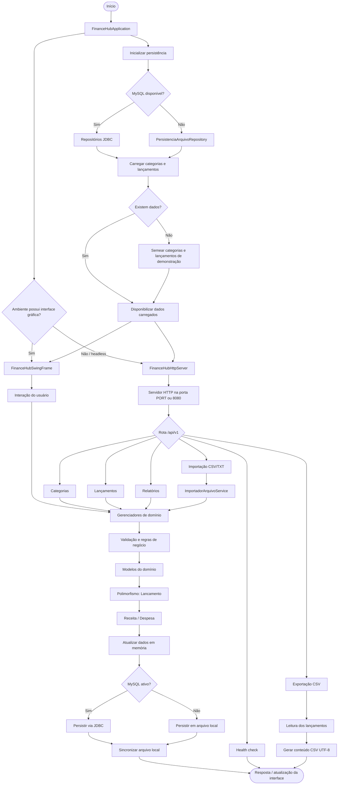

# Fluxograma do FinanceHub

Este diagrama representa o comportamento implementado no backend Java 21. Os caminhos de execução desktop e HTTP compartilham os serviços e o domínio; a persistência usa MySQL quando disponível e arquivo local como alternativa.

## Leitura do fluxo

1. **Inicialização:** `FinanceHubApplication` escolhe Swing quando existe ambiente gráfico ou a API HTTP em modo headless.
2. **Persistência:** a aplicação tenta conectar ao MySQL. Se a conexão não estiver disponível, recupera os dados do arquivo local. Se não houver dados, cria registros de demonstração.
3. **Regras de negócio:** as ações passam pelos gerenciadores, que trabalham com os modelos `Categoria`, `Lancamento`, `Receita` e `Despesa`.
4. **API:** o servidor Java expõe health check, categorias, lançamentos, relatórios, importação e exportação sob `/api/v1`.
5. **Arquivos:** `ImportadorArquivoService` interpreta CSV/TXT; a exportação gera CSV em UTF-8.
6. **Persistência das alterações:** os dados são atualizados nos gerenciadores e sincronizados com o mecanismo de persistência ativo e com o arquivo local.

> O fluxo representa a implementação Java atual. Gateway PHP e clientes Web/mobile não integram o caminho de execução documentado.
